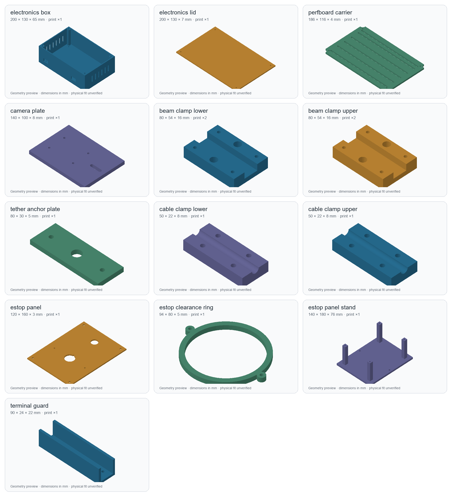
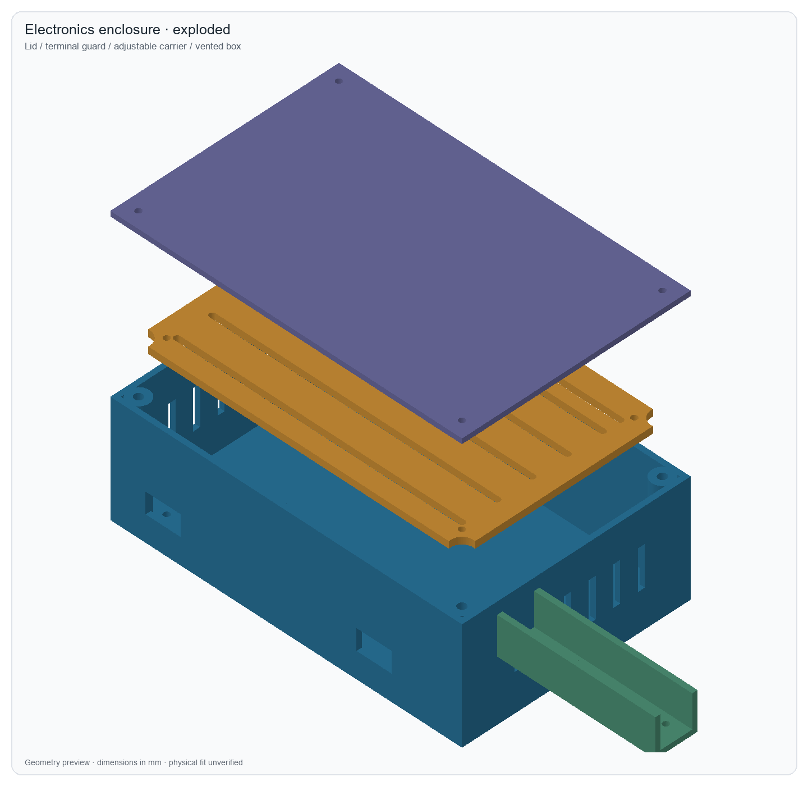
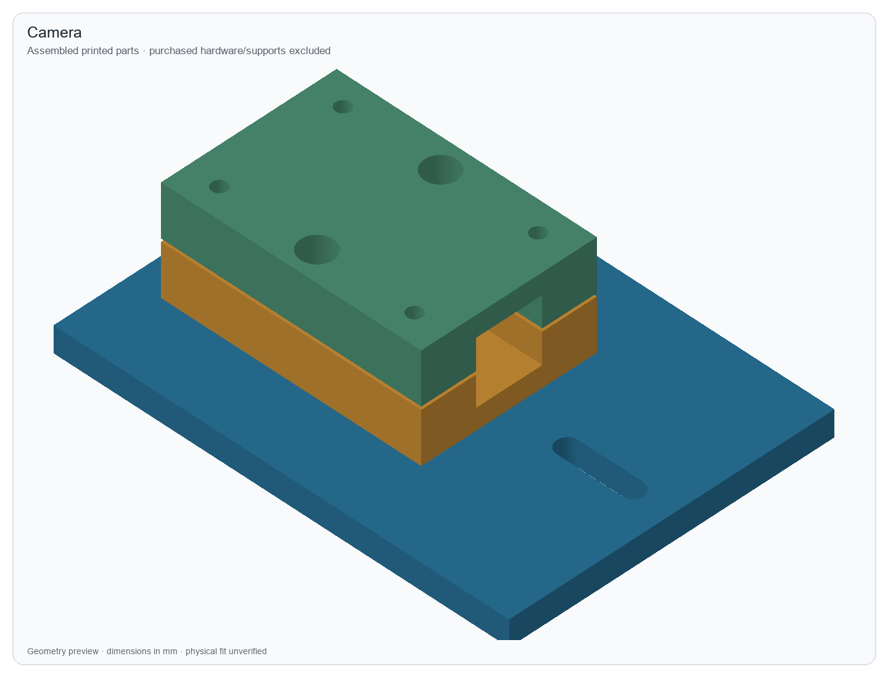
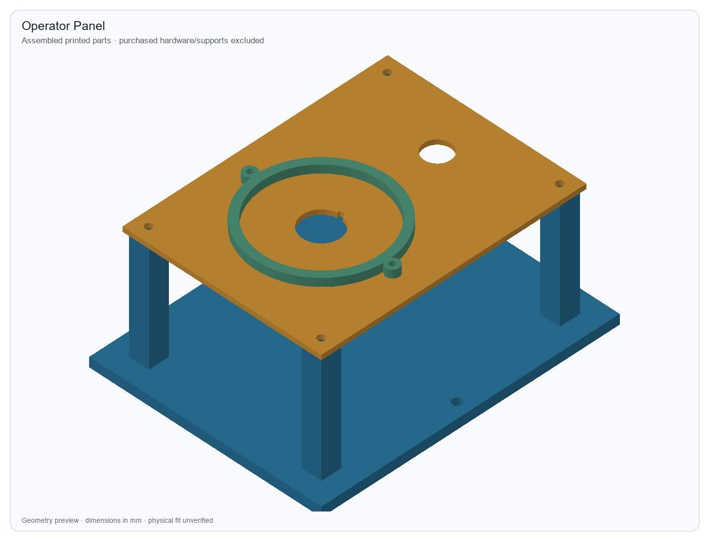

# Offboard accessories

The accessory package contains 13 printable part designs and five assembled layouts. Each part has an editable FreeCAD document, an analytic STEP solid, and a watertight STL. The assemblies also have self-contained FreeCAD documents with their component feature histories. These models cover the electronics enclosure, camera adapter, overhead tether clamp, cable strain relief, and operator panel.



The default parts fit a 220 × 220 mm print bed. Hardware fit, printed strength, camera stability, cable retention and switch access have not been tested physically. Use the measurements and fit checks below before installing them.

## Files and editing

- [Native FreeCAD files](../hardware/native/accessories/) retain dimension properties, Box/Cylinder primitives, and Cut/MultiFuse operations. Open a part, select **Editable dimensions in millimetres**, change a property and recompute. The final object is `Final`; assembly final objects are `FinalAssembly`.
- [STEP files](../hardware/step/accessories/) contain curved analytic surfaces and solid geometry. Import a part or complete assembly into Onshape for direct solid editing. STEP does not transfer the FreeCAD feature history.
- [Print files](../hardware/prints/accessories/) include STLs, inspected previews and [quantities/orientations](../hardware/prints/accessories/print_manifest.csv). STL coordinates already put the chosen bed face at Z=0. The lid is flipped to print its outer flat face down and retaining lip up; native/STEP coordinates retain its assembly orientation.
- [Parameters](../hardware/freecad/accessories/parameters.json), [builder](../hardware/freecad/accessories/build_accessories.py) and [verification manifest](../hardware/freecad/accessories/cad_manifest.json) make regeneration reproducible. Assembly documents are independent copies: edit the source part and regenerate to propagate a revision to all layouts.

All dimensions use millimetres. Related dimensions must change together. For example, changing enclosure footprint requires changing its carrier and assembly offsets; changing beam clamp footprint requires changing the camera bolt pattern and tether anchor. A single dimension edit is verified to recompute each part, but arbitrary combinations are not guaranteed to fit. The builder refuses invalid or intersecting assembled solids.

Use the task-local FreeCAD installation from `scripts/bootstrap_freecad.py`. From the project root in PowerShell:

```powershell
& '.tools/freecad/FreeCAD_1.1.4-Windows-x86_64-py311/FreeCADCmd.exe' `
  -u '.tools/accessories-user.cfg' -s '.tools/accessories-system.cfg' `
  --log-file '.tools/accessories-freecad.log' `
  'hardware/freecad/accessories/build_accessories.py'
```

The preview renderer needs optional `pillow`, `numpy`, and `trimesh` in a task-local Python environment. Run `hardware/freecad/accessories/render_accessories.py` after regeneration. It renders exported geometry and verifies STL/native bounds within the specified 0.12 mm tessellation tolerance.

After the builder finishes, restore its saved display state with `python scripts/cad_visibility.py --manifest hardware/freecad/accessories/cad_manifest.json`. Follow [the complete regeneration order](cad-regeneration.md) when changing both CAD families, then review the independent kernel report before repackaging.

## Electronics enclosure



The vented box is 200 × 130 × 65 mm with 3 mm walls and floor. The 186 × 116 × 4 mm carrier sits on four purchased 8 mm standoffs, leaving clearance beneath solder joints. Its six 3.4 mm slots accept movable M3 board standoffs. Their default Y positions are 12, 32, 52, 72, 92 and 102 mm; adjust these to the actual controller and perfboard mounting holes. Mount the ESP32 and watchdog logic as separate boards and keep solder joints clear of metal fasteners. Measure every purchased board: the model makes no claim that an unspecified ESP32 board has a particular hole pattern.

The terminal guard is an open-ended 90 × 24 × 22 mm channel. Its two M3 holes align with the carrier's rear slot row in the supplied layout. Place the low-voltage motor terminals beneath it and route their current through suitable wire and rated terminals, following the [watchdog circuit](watchdog-circuit.md). Do not run motor current through the carrier or thin perfboard tracks. External USB/controller leads pass through two 20 × 12 mm front openings; fit edge protection and strain relief to the actual cable. Vents and open cable ports mean this box has no ingress protection rating. The mains power supply stays outside it.

Use four M3 screws through the floor, four 8 mm M3 standoffs beneath the carrier and four M3 carrier screws. Allow fastener length for the 3 mm floor and 4 mm carrier without protruding into wiring. Use measured 6–10 mm board standoffs above the carrier; the installed boards and components must stay below the lid. Four M3 lid screws engage brass heat-set inserts in the corner bosses. The 4.6 mm diameter, 6 mm deep insert bore is a candidate: test a small printed coupon with your exact insert before printing the box. The lid has 0.3 mm nominal clearance and boss reliefs; check lid fit before wiring.

## Camera support and tether



Supply a rigid purchased overhead frame or an existing desk beam. The default clamp is for a **measured 20 × 20 mm rectangular metal beam**; 2020 extrusion is a candidate, not a measured component. Set `MeasuredBeamWidth` and `MeasuredBeamHeight` to the purchased beam, account for coatings, and test one clamp first. The groove includes 0.4 mm width clearance and a nominal 1 mm mating gap. Do not attach the clamp to a thin camera cable or a flexible tube.

Print two lower and two upper clamp halves: one pair for the camera, one for the tether. Four M4 bolts, washers and nuts tighten each pair. M4 × 50 mm bolts are a starting length for the shown camera stack; verify engagement and clearance against the purchased hardware. Tighten evenly, check for slip and avoid crushing the printed flanges. The support frame, its feet/desk attachment and its load capacity are purchased/measured items; this package does not supply a freestanding printed boom.

The 140 × 100 × 8 mm camera plate bolts below one clamp. Its 6.7 mm clearance slot accepts a purchased **1/4-20 UNC tripod screw or tripod ball head**, with 20 mm travel outside the clamp body so the screw remains accessible. Standard 1/4-20 mounting hardware is documented by [Thorlabs](https://www.thorlabs.com/images/Catalog/V19_02_Optomech.pdf). Measure the camera's socket depth and use a screw that cannot bottom out. A camera without a tripod socket needs its own purchased adapter. No camera body dimensions or printed screw threads are assumed.

The tether plate shares the two outer M4 bolts on one flange of the second clamp. Its 10 mm cord eye aligns with a clamp passage. Use a soft cord and swivel to connect it to the robot's 10 mm tether mast eye. The cord should support cable drag with enough slack for the entire arena, including turns and gripper motion. It is not a load-rated fall arrest. Add an independent retention cord for the camera to the purchased support, and check that neither cord obstructs the overhead view or drags the robot.

The separate two-piece cable clamp has a nominal 6 mm channel with 0.2 mm compression. Set `MeasuredCableDiameter` to the real cable and reduce compression if the jacket deforms. Four M3 screws/washer/nuts fasten it. Attach the lower half to the measured support using an appropriate purchased bracket or strap; its four through-holes remain accessible. Test retention by pulling the disconnected cable gently, then inspect the jacket and connectors. The tether is routed separately from the clamped electrical cable.

## Operator panel



The exact intended emergency stop is **Omron A22E-M-02**, the non-lighted 40 mm mushroom with two NC contacts. Omron's A22E mounting drawing specifies a 22.3 mm hole with +0.4/0 tolerance and a 1–5 mm panel. With the antirotation lock ring, the key is 3.2 mm wide with +0.2/0 tolerance and the complete cutout is 24.1 mm high with +0.4/0 tolerance. This model uses a 22.5 mm circle, 3.3 mm key, 24.3 mm overall cutout and a 3 mm panel. Use Omron's rubber washer, locking hardware and assembly procedure; check the finished print dimensions with calipers. [Official Omron drawing and installation instructions, printed pages 46 and 48](https://assets.omron.eu/downloads/latest/datasheet/en/a22e_a22ne-p_aa22ne-pd_datasheet_en.pdf).

The optional 5 mm high ring leaves a 70 mm opening around the 40 mm head: nominal radial finger clearance is 15 mm. Omron shows the non-lighted head's 18.5 mm front dimension. This supports the chosen low ring envelope, but does not establish operating stroke or prove that a particular hand can press and twist-release the assembled switch. Test unobstructed palm operation and release from every accessible approach. Remove the optional ring if it reduces access. It is not an Omron-approved guard or a certified emergency-stop assembly.

The second panel cutout is dedicated to **Adafruit 1505**, a black normally-open momentary arm button. Its nominal 16 mm hole is centred at X=60, Y=130 mm. The vendor lists a maximum 15.56 mm shaft dimension and 29.4 mm total height, which fit the nominal hole and 70 mm rear space; measure the delivered button, nut, print and lead clearance before assembly. Connect its two contacts between **GPIO26 and GND**; the firmware uses an internal pullup. Label it **PRESS TO AUTHORIZE**, using the [printable panel labels](../hardware/prints/accessories/operator-panel-labels.svg). Place the authorization label centred at X=60, Y=110 mm and the E-stop label at X=60, Y=15 mm, clear of the button and optional ring. A fresh press edge opens the MCU's five-second authorization window and energizes the servo bus for telemetry preparation; holding the button does not keep renewing that window. A separate trusted host arm command is still required, and it consumes the fresh press. Releasing the button or a motor-disarmed state does not replace the independent E-stop. [Adafruit's dimensions and contact description](https://www.adafruit.com/product/1505).

The open stand provides 70 mm rear clearance and four aligned M4 through-holes. Use four M4 × 90 mm bolts with washers and nuts as a starting selection, checking actual stack length. Place purchased rubber feet taller than the projecting underside bolt heads/nuts, or recess the measured fasteners in a revised model. Secure the stand through its two M5 base holes to the measured desk/support. Keep both buttons reachable and the wiring visible for inspection. Both E-stop NC circuits and their coil/sense wiring are described in [the circuit guide](watchdog-circuit.md). Low-voltage power connectors belong in the external electronics enclosure with measured strain relief, rather than in the arm-button cutout.

## Verification and assembly checks

FreeCAD 1.1.4/OpenCascade verified all 13 part designs as positive-volume, closed, valid single solids. Each STEP export reimports with the same solid count and volume. Native edits recompute through actual parameter expressions and CSG operations. All five assembly layouts contain the expected closed solids and have zero positive-volume intersections between their printed components. Each STL reloads as watertight with positive volume; all chosen print faces are at Z=0. Inspect the [manifest](../hardware/freecad/accessories/cad_manifest.json) and previews for the exact revision.

Start with PETG, 0.2 mm layers and at least four perimeters as provisional print settings, then inspect layer bonding and fit. Print one beam clamp, the panel and insert/fastener coupons before the larger parts. With motor power disconnected, check board clearance, terminal shielding, lid closure, camera bolt access, clamp slip, cable motion and full emergency-stop operation. Camera calibration must remain valid after the support is loaded or bumped; recapture and validate the measured reference points after any movement. A successful CAD check does not establish printed strength, thermal performance or electrical cutoff time. Firmware stays disabled until the physical tests in the control and circuit guides pass.
