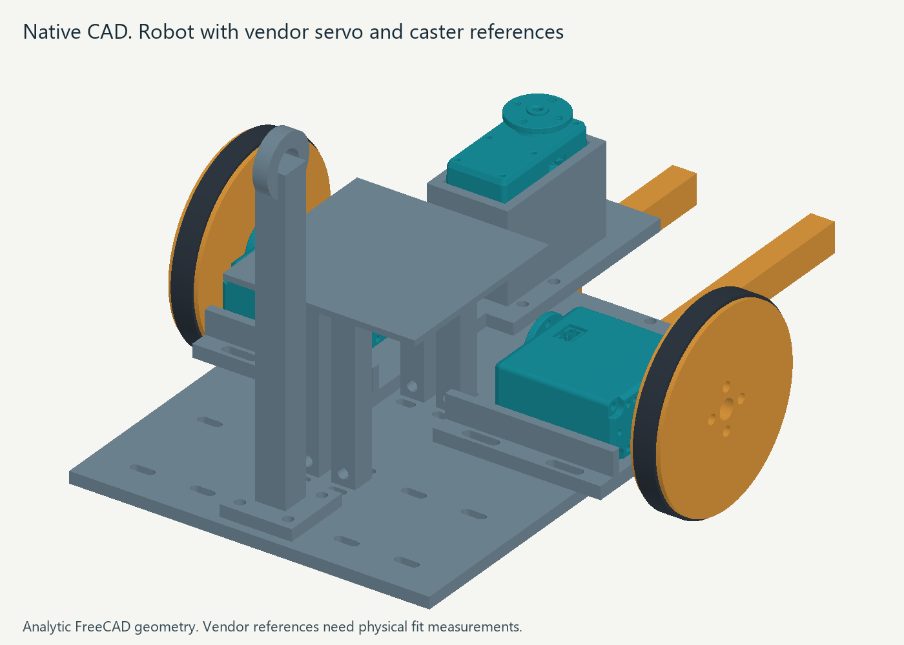

# Editing the mechanical CAD

Use the native FreeCAD files when you want the editable construction tree. Use STEP files when you want to import solid parts into Onshape. The existing STL files remain the print meshes.



## What is included

| Files | Purpose |
|---|---|
| `hardware/native/robot/*.FCStd` |27 native part documents with editable Box, Cylinder, Fuse, Cut, and Compound features|
| `hardware/step/robot/*.step` |Matching analytic solid parts for Onshape and other CAD tools|
| `hardware/native/robot/robot_playground_assembly.FCStd` |Self-contained robot, objects, gate, frame, calibration mounts, and vendor references|
| `hardware/step/robot/robot_playground_assembly.step` |The corresponding assembled solid geometry|
| `hardware/freecad/robot/build_robot.py` |FreeCAD construction and export script|
| `hardware/freecad/robot/cad_manifest.json` |Part names, paths, dimensions, volumes, and mesh comparison results|
| `hardware/freecad/robot/assembly_instances.json` |Component names and assembly placements|
| `hardware/cad/parameters.json` |Recorded millimetre dimensions used by the source constructors|
| `hardware/cad/generate.py` |Parametric source shared by the STL and analytic CAD builds|

The STEP files contain analytic planes and cylinders. They were built from native CAD operations rather than converted from STL triangles. All 27 parts are single valid, closed solids. Analytic volumes differ from the original meshes by at most 0.072 percent because the meshes approximate circles with polygons. Their bounding dimensions match within numerical precision. The independent verification report is under `hardware/freecad/validation/`.

The assembled scene includes 74 printed component instances. That is the print manifest's quantity of 82, less five fit coupons, two optional caster shims, and the standalone overhead tie plate. Three ST3020 servo references and one Pololu950 reference add four purchased components. A servo reference contains multiple vendor solids. These references describe vendor geometry, not a measured delivered part. Hardware fasteners and routed wires are not modelled. The overhead tie plate has its own native and STEP files; its support belongs to the separate camera and tether fixtures.

The accessory CAD package has its own files under `hardware/native/accessories/` and `hardware/step/accessories/`, including the external electronics and camera-support parts. Consult their manifest and the mechanical instructions before adapting a mounting interface.

## Edit in FreeCAD

1. Open the part's `.FCStd` file in FreeCAD. `FinalPart` is the completed solid. Expand the part's editable construction group to inspect the underlying operations.
2. Select a Box or Cylinder and edit its dimensions in the Data property panel. Select a Translate or Rotate Compound to edit its Placement. The downstream cuts and fuses remain linked to these native features.
3. Recompute the document after an edit. Check the final solid with Part's geometry check and measure the changed interface. A valid solid alone does not prove the hardware fits.
4. Export `FinalPart` as STEP for CAD exchange or as STL in millimetres for printing. Exporting the intermediate cutter primitives would produce the wrong part.

The assembly contains its construction masters and placement links inside one file. It does not rely on external FreeCAD documents. Change an instance's Link Placement to move it. Changing a construction master updates its linked instances when the document recomputes. The saved source-parameter JSON is a record; editing that text property does not drive the primitives. For coordinated source changes, edit the actual parameter file and regenerate both CAD and print meshes.

These are native CSG feature trees. They are not a Part Design sketch-and-pad history, and the vendor servo reference is an imported purchased shape. The provided objects can be edited directly in FreeCAD without installing a custom feature-proxy module.

Regenerate the analytic files with the task-local FreeCAD runtime:

```powershell
& '.tools/freecad/FreeCAD_1.1.4-Windows-x86_64-py311/FreeCADCmd.exe' -u '.tools/mechanical-user.cfg' -s '.tools/mechanical-system.cfg' --log-file '.tools/mechanical-freecad.log' 'hardware/freecad/robot/build_robot.py'
python scripts/cad_visibility.py --manifest hardware/freecad/robot/cad_manifest.json
```

This script runs inside FreeCAD's Python 3.11. It reads the constructor functions without importing the Python 3.14 manifold or rendering extensions. Run the STL generator separately with the workspace Python when source dimensions change. Regeneration overwrites the generated CAD files, so keep hand-edited copies under different names.

Follow [the complete regeneration order](cad-regeneration.md) when changing the build. It covers both CAD families, saved display state, independent checks and packaging.

## Import and edit in Onshape

Create an Onshape document and import the selected `.step` file. Use a per-part file when adjusting one printable part, or the assembly file when checking placement. The models use millimetres and Z up. Leave the Y-axis-up option off and disallow faulty parts. After translation, confirm the expected solid count and measure a known dimension, such as the chassis length of 160 mm.

STEP transfers solid geometry. It does not transfer the FreeCAD operation history. Add sketches and features to the imported solid or use direct editing to change faces and holes. To keep source-driven dimensions, edit the FreeCAD native file, export a new STEP, and update the imported part. Onshape documents these import and editing limits in [Working with imported CAD](https://cad.onshape.com/help/Content/Document/working_with_imported_cad.htm).

The assembly is a placement reference. It does not supply Onshape motion mates. Add your own mate connectors and slider/revolute relationships if you want an interactive assembly. The gate's motion is 100 mm and the initially checked gripper range is -20 to 35 degrees. Imported vendor sub-solids may appear as several parts; keep them together as a purchased component when arranging the assembly.

No Onshape account import was performed here. The exported STEP files were reopened and checked in a fresh local CAD kernel. Follow the import checks above to confirm Onshape's translation before editing or printing.

## Fit remains a physical check

Read [the mechanical build instructions](../hardware/mechanical.md) and print the five coupons before the chassis. The ST3020 drawing and original STEP disagree on body height. Stock horn thread, screw engagement, cable clearance, tire fit, shaft loads, and gripper force still require measurements. CAD validity and editable geometry do not establish those fits.

All tracked tags and calibration references use a nominal 74 mm plane. Measure the actual mounted paper surface before calibrating. The object tag stems stay above the floor-height gripper in the checked nominal grasp poses.
