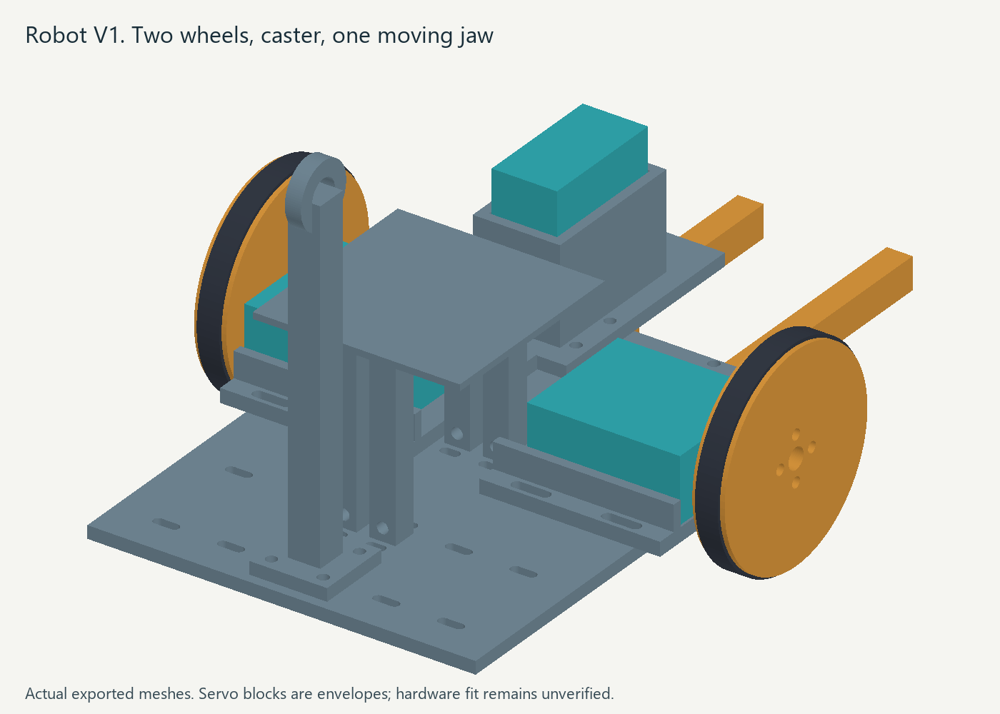
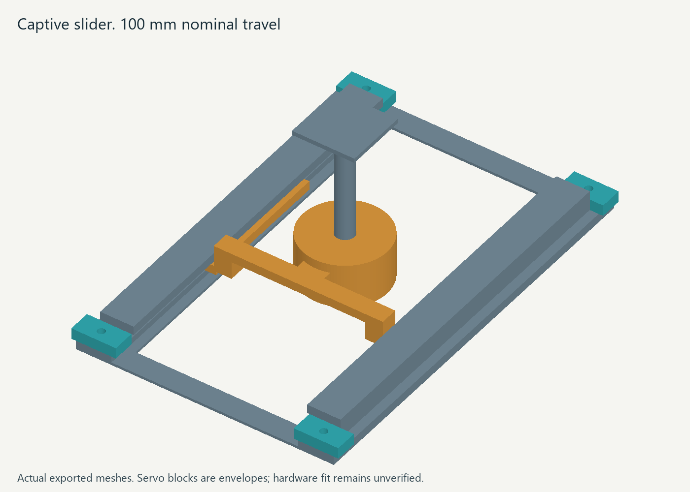

# Robot V1 mechanical build

This package contains a printable differential-drive robot, three pucks, a captive slider, and an arena frame. Two ST3020 servos drive the wheels. A third servo moves one front finger against a fixed finger. A purchased ball caster supports the rear. The computer, servo adapter, and power supply stay off the robot.

The CAD is ready for a fit-first build. Print the coupons before the chassis. Physical fit, traction, grip force, load capacity, and cable drag remain untested.



## Files and verified results

- `cad/parameters.json` contains millimetre dimensions and arena size.
- `cad/generate.py` is the parametric solid source and STL exporter.
- `prints/print_manifest.csv` lists quantities, materials, and print orientation.
- `prints/mesh_report.json` records dimensions, volume, topology, and triangle counts.
- `cad/verify_geometry.py` checks nominal assembled solids and motion. Its report is `prints/geometry_verification.json`.
- `prints/arena_layout.json` gives exact wall positions and rotations.
- `cad/vendor/` preserves the original vendor drawing, STEP, and caster drawing.

There are 27 default STL files. Each exported STL reloads as one connected, watertight solid with consistent winding and positive volume. The nominal assembly passes 1,633 intersection checks. Those cover static parts, 56 finger angles from -20 to 35 degrees, 101 slider positions through 100 mm of travel, and robot grasp poses at both gate endpoints and its centre. A tagged loose puck is also checked. Fasteners, wiring, stock horns, tire fit, load capacity, and physical hardware were not tested. Teal blocks in the images are servo envelopes.

Regenerate with Python 3.14:

```powershell
python -m pip install --target hardware/cad/_deps -r hardware/cad/requirements.txt
python hardware/cad/generate.py
python hardware/cad/verify_geometry.py
```

The dependencies stay inside this task. The optional `inspect_vendor.py` uses the existing OpenCascade package to inspect the original STEP.

## Dimensions for control

Forward is +x, left is +y, and the drive axle is the origin.

| Quantity | Nominal value | Check during assembly |
|---|---:|---|
| Wheel rolling radius |32.5 mm|Measure travel over several tire revolutions|
| Wheel centre spacing |154 mm|Measure after aligning the horns and cradles|
| Chassis plate |160 x 120 x 4 mm|Runs from x=-110 to x=50|
| Chassis bottom above floor |14 mm|Level with caster spacer and shims|
| Printed footprint, jaw closed |240 x 164 mm|Screw heads add width; use a 160 mm conservative radius initially|
| Caster location |x=-82 mm|Check rear load and free rolling|
| Moving finger axis |x=60, y=23 mm|Set stock horn face at z=12 mm|
| Finger floor gap |2 mm|Check the entire arena floor for scraping|
| Moving finger |70 x 8 x 10 mm|Fixed finger also reaches x=130 mm|
| Initial finger range |-20 to 35 degrees|Calibrate servo counts; stop before contact|
| Closed finger gap at zero |38 mm|Pads and servo zero alter the grip|
| Puck |38 mm diameter, 20 mm high|Use soft grip pads and low torque|
| Robot marker plate |64 x 64 mm, top at z=74 mm|Marker centre is x=-45, y=0|
| Object marker plate |28 x 28 mm, top at z=74 mm|Full tag footprint, including margin, must fit|
| Gate travel |100 mm, from -50 to 50|Keep both end stops installed|
| Default arena inside |1000 x 1000 mm|Feet extend at least 20 mm outside each edge|

Apply the robot marker's 45 mm horizontal offset when estimating axle pose. Robot, puck, and gate tags all sit on a common 74 mm plane. Verify the actual print surface and paper height on the assembled parts before calibration. Object posts raise only their tags; the 38 mm grip surfaces stay near the floor.

Parameters are editable CAD inputs. Arbitrary robot changes do not automatically remain compatible. The holes, tower positions, and clamp locations form a fixed V1 layout. Arena size automatically changes wall lengths, print quantities, and placement coordinates. After changing robot dimensions, rerun the solid checks and inspect the renders.

## Vendor evidence and fit coupons

[Waveshare's ST3020 wiki](https://www.waveshare.com/wiki/ST3020_Servo) lists a 40.2 x 20.2 x 40 mm body. The [product drawing](https://www.waveshare.com/img/devkit/accessories/ST3020-Servo/ST3020-Servo-details-size.jpg) labels 40.1 mm body height. The housing solids in the linked [original STEP](https://files.waveshare.com/upload/6/61/St3020_servo.rar) span about 47.3 mm along the output axis. Measure the delivered servo before choosing the fit.

The STEP confirms a 20 mm output horn and four peripheral hole centres on a 14 mm pitch circle. Its peripheral holes are modelled as 2.5 mm cylinders. That geometry does not establish a screw thread. The printed interfaces use 3.4 mm clearance holes. Keep the stock aluminum horn for the spline, and confirm the supplied screw thread and safe engagement.

The drive cradle's long-body gap is 42 mm. Its open shaft direction lets the case slide to align the wheels. The inverted gripper tower has a 41 x 21 mm opening and a 48 mm body-height envelope above the horn. Straps hold the cases, so their tab-hole patterns are not fit dependencies.

Print parts 01 through 05 with the intended final material and settings:

1. Align the horn coupon with the actual stock horn. All four holes must match without force. Record horn diameter, thickness, screw thread, and safe screw engagement. Confirm centre-screw access.
2. Measure body length, width, axial height, shaft offset, connector clearance, and horn-face distance from the case. Try the 40.2 mm body gauge. If the case exceeds the tower opening, change the source before printing the tower.
3. Pass actual screws through the hole coupon. Its holes run left to right as 2.5, 2.8, 3.0, 3.2, and 3.4 mm. Choose clearance from the print, and drill final holes if needed.
4. Remove support from the gate rail coupon and slide its runner through the channel. It must move freely and remain below the lip. Nominal side clearance is 0.5 mm; vertical clearance is 0.6 mm. Fix tight channels before printing the full gate.
5. Trial-print one cradle and one wheel. Set the output axis at z=32.5 mm and wheel inner face at absolute y=72 mm. Check cable plugs and screw tips while turning the wheel by hand. Both vendor body-height variants need this alignment.

Waveshare warns that an overlong attachment screw can touch the case and damage the servo. Check screw-tip clearance with power off. Do not print a guessed spline.

## Purchased parts

| Item | Quantity | Notes |
|---|---:|---|
| ST3020 servo |3|Confirm delivered revision and included horns|
| Stock output horn |3|Compare against the vendor drawing and fit coupon|
| Pololu 950 plastic ball caster |1|Purchased rolling contact|
| M2 x 12 screws, washers, nuts |2 sets|Caster mount; verify the actual stack|
| M3 x 16 screws, washers, nuts |16 sets|Eight cradle, four gripper tower, four tether mast fasteners|
| M3 button-head x 20 screws, washers, nuts |2 sets|Fixed jaw. Lower counterbores keep heads above the floor|
| Horn-compatible screws and washers |8|Four per wheel. Wheel thickness is 10 mm; about 14 mm may suit an M3 horn with a 1 mm washer. Measure engagement|
| Horn-compatible button-head screws and washers |4|Moving jaw. Counterbores leave 7.8 mm above the seat; about 12 mm may suit an M3 horn with a thin washer. Measure engagement and tip clearance|
| M3 button-head x 12 screws, washers, nuts |4 sets|Gate stops; insert upward from lower base counterbores|
| M3 button-head x 12 screws, washers, nuts |40 sets|Printed arena. Heads sit in lower wall-foot counterbores|
| 2.5 to 3 mm wide cable ties |About 24|Servo straps, marker feet, cable strain relief, ballast|
| Thin rubber or foam |Small sheet|Grip pads and clamp packing|
| TPU 95A filament |Two tire rings|Nominal radial interference is 0.2 mm|
| Flat steel washers or another mass |About 100 g available|Rear ballast if needed|
| Removable tape |As needed|Tags, caps, and arena anchors|
| Stable overhead boom and camera mount |1|Use a purchased support rated for the camera; the printed plate carries the cable|
| Small rotating support-cord swivel |Optional|Electrical cable still accumulates twist|

[Pololu's drawing](https://www.pololu.com/file/0J1636/pololu-ball-caster-with-0-375in-ball.pdf) specifies 13.5 mm mounting-hole spacing and 10.1 mm caster height. The printed 3.9 mm spacer brings the chassis underside to 14 mm. Its 2.5 mm holes accept M2 screws. [Pololu's product page](https://www.pololu.com/product/950/) describes the caster as suitable for small robots with a load of only a few pounds. Check rear load and free rolling.

## Print and assemble

Start with PETG, a 0.4 mm nozzle, 0.2 mm layers, four walls, and 25 to 35 percent infill. Use five walls near jaw and cradle mounting holes. Print the marker tower with its broad plate on the bed, then invert it. Follow the manifest for supports. Remove all support from channels, strap windows, and tether eyes. Use the printer's TPU profile for the tires.

1. Bolt the cradles to the chassis with centres at x=-10, y=+40 and -40. Leave slotted joints loose. Put each servo's narrow 20.2 mm dimension vertically on the cradle shelf, output shaft horizontal. Use two ties per servo and keep both connectors clear.
2. Attach each printed wheel to a stock horn through its four clearance holes. Fit the TPU tire between the rims. Select compatible short screws. Spin the wheels by hand with torque off, align centres to 154 mm, then tighten the cradles. Measure the actual track and rolling radius.
3. Bolt the caster and spacer below the chassis at x=-82. Use optional 0.5 and 1 mm shims to level the plate. Both wheels and caster must touch the floor without rocking.
4. Bolt the fixed jaw below the chassis through x=40 and 48, y=-23. Its mounting pad ends at z=14, flush with the underside. Use button-head screws in the lower counterbores so heads do not scrape the floor.
5. Bolt the gripper tower on top through x=30 and 45, y=7 and 39. Slide the inverted servo through the front cutout and set its horn face at z=12. Strap it through the wall windows. Attach the moving finger below the horn with compatible button-head screws in its counterbores. Its bottom is at z=2; its arm points along +x at zero.
6. Add thin soft pads near x=100 to 125. With torque off, sweep the finger from -20 to 35 degrees. Keep wiring above the fingers. Test a 38 mm puck with low closing force.
7. Invert the marker tower. Feet sit at x=-70 and -20, y=+6 and -6. Tie the horizontal foot holes to the paired chassis slots. Apply the robot tag on top with its complete white margin visible.
8. Bolt the tether mast at x=-95, y=0. Tie the cable to its eye and leave slack to the servos. A pull must load the mast rather than a connector.
9. Check balance with the jaw open and holding a puck. The centre of mass should be 10 to 45 mm behind the axle, with similar wheel loads. If the caster lifts or the robot falls forward, fix two flat rear ballast packets near x=-82, y=+34 and -34 through the ballast slots. Keep the marker feet and tether mast clear.

## Gate and arena



Slide the gate part through an open end, then install four stop blocks, one on each rail at both ends. Insert the stop screws upward through the base counterbores and put washers and nuts above the stops. The gate is 180 x 116 mm with 100 mm travel. Its retained feet and raised rear bridge leave the 38 mm knob accessible to floor-height fingers. Approach from the front, opposite the bridge, and keep fingers within the central 76 mm corridor. The widened corridor clears the moving finger's round hub. The separate stop blocks leave the finger corridor open throughout travel and stay below the chassis. Anchor the base so the slider moves rather than the fixture. It should move under a 1 N hand pull before a powered trial.

For the default square arena, print 20 wall segments, 16 straight joiners, and four corner joiners. Inside wall faces lie at local y=0; feet point outside. Use `arena_layout.json` for centre positions and rotations. Put joiners on top of the feet. Insert M3 button-head screws upward through the lower counterbores, then add nuts above the joiners. Check all heads remain flush with the floor and tape the outside feet down.

Changing `arena_inside` generates exact equal-length wall segments of at most 200 mm and updates quantities and coordinates. Rectangular arenas may add a second wall STL. Use a flat matte floor and reserve at least 1040 x 1040 mm for the default frame, with more room for corner joiners. A wood frame with the same measured inside dimensions is a quicker alternative.

Part 41 is a marker plate with an 8 mm diameter stem. Print its plate on the bed with the stem upward. Invert it and glue its stem into the puck's 8.4 mm socket. The plate top must be at z=74 mm. The puck socket is 8 mm deep and the gate-knob socket is 10 mm deep, which puts both plates on the same plane. Use a flat surface and a height gauge while the glue sets. The posts and plates stay above the jaw sweep and ahead of the gripper servo tower in the checked grasp pose.

Use unique tags whose full footprint fits the 28 mm plates. Keep puck shape and mass constant between trials. Match the gate's origin, axis, travel, tag ID, and tag-to-slider offset to the controller configuration. The rendered object positions are illustrative, rather than a software calibration file. A tilted tag or one at a different height invalidates the common-plane assumption.

Print four calibration bases, part 42, and four extra marker stems, part 41. Glue each stem into a base socket, with its tag top at the same 74 mm plane. Tape these stands down outside robot paths and measure the tag-centre coordinates. Use those raised reference centres for a single homography. Reference points on the floor would create a floor-plane mapping and leave parallax error in the raised tags. The default part-41 quantity includes four object stems and four calibration stems.

`prints/calibration-crosshairs-a4-300dpi.png` supplies four plain crosshair references. Print at actual size with fit-to-page disabled and measure its 100 mm ruler before cutting out the 28 mm squares. Match the labelled centre in the camera image to its measured world coordinate. Plain references avoid adding more tracked object IDs. Remove the stands after calibration if they obstruct a path, while keeping the camera and tracked marker mounts fixed.

## Tether and physical acceptance

Fix the overhead camera high enough to see the whole arena with margin. Attach the printed tie plate to a stable boom through its four strap slots. Route lightweight servo cable through its eye, with a slack service loop. Add a separate soft support cord if the cable is heavy. Keep its robot end above the marker and outside the jaw sweep.

Measure tether pull at the centre and all corners. Aim below 0.2 N, with no wheel lift or position-dependent steering. Add slack or reduce cable weight if drag changes paths. A swivel carries the support cord; it does not permit unlimited electrical cable rotation. Use rotation limits and unwind between trials.

Physical acceptance requires ten straight passes without a traction or alignment problem, ten low-force puck grips and releases, ten full slider strokes without binding or lift-out, visible tags at every arena corner, and stable balance while the tether moves. Record actual rolling radius, track, tag offsets and heights, jaw zero and endpoints, gate force, and safe horn screw engagement. These are checks to perform on the build, not results claimed by this package.

Waveshare specifies output torque but the checked sources do not rate the output bearings for wheel radial load. These direct-drive wheels put robot weight on the servo shafts. Keep the floor smooth, avoid impacts, and check shaft play, heating, and horn screws after initial passes. A verified radial-load rating or an external wheel bearing is needed before increasing mass or duty cycle. Size the tether conductors for the measured and limited motor current; light cable must not mean undersized power wire.
